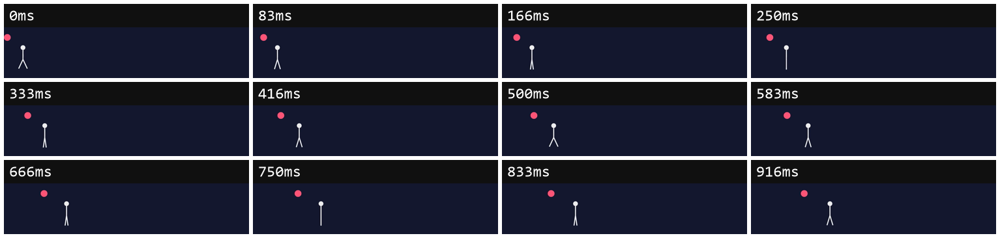
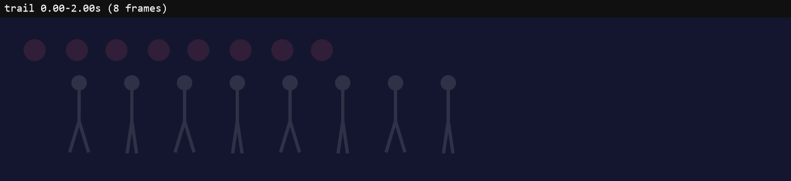

# frame-judge

**Your AI keeps calling its own websites, animations and videos "great". frame-judge makes it prove it.**

Your AI builds the work and renders it. Then a second AI, the critic, judges only what's actually on screen, against what you asked for. It never sees the code, and it never hears the builder's opinion. Every complaint has to point at a real frame. Nothing gets called done until the critic passes it.

Works with **Claude Code**, **Codex**, **Antigravity**, and any AI agent that supports [Agent Skills](https://agentskills.io).

## Install

**Send this link to your AI:**

> Install this skill: https://github.com/mirac221/frame-judge

That's it. Your AI reads the setup steps below and does the rest.

## What the critic sees

The critic doesn't read code. It gets frames: screenshots per device, timestamped filmstrips, and motion trails where anything that should stay still stays sharp.




That's from a real test. The request was a dark landing page with no gradients and a walking robot mascot. The AI's first attempt got this back from the critic:

> "This is the stock purple-to-blue gradient 'Unlock the power of AI' template. The brief banned gradients and asked for dark everywhere, and the 'robot' is a gliding stick figure with a mystery pink dot."

Each finding behind that verdict pointed at specific frames, and a script checked every one before it counted.

## What changes for you

- **The model question:** your AI asks once which model the critic should use, on agents that support it (Claude Code, Codex). Cheaper or sharper, your call.
- **Everything gets checked:** phone, tablet and desktop; hover and error states; the whole animation as timestamped frame strips. Strips are sampled (12 fps by default), with every frame shown around any sudden jump or stall it detects.
- **A verdict, not "looks great!":** you get the critic's verdict, what got fixed, and what's still open.
- **No endless loops:** at most 3 review rounds.

## Requirements

- Node.js 18 or newer
- ffmpeg
- For websites: Playwright (your AI will offer to set it up)
- An AI model that can see images

## Setup steps (for the AI doing the install)

You were sent this link to install frame-judge. Do this, then tell the user what you did.

**1. Clone this repo into your skills folder as `frame-judge`.**

```
git clone https://github.com/mirac221/frame-judge <skill folder>
```

On Windows PowerShell, use `$HOME\...` instead of `~/...`.

| Agent | Skill folder | Critic file | Copy the critic to |
|---|---|---|---|
| Claude Code | `~/.claude/skills/frame-judge` | `agents/claude-code/frame-critic.md` | `~/.claude/agents/` |
| Codex | `~/.agents/skills/frame-judge` | `agents/codex/frame-critic.toml` | `~/.codex/agents/` |
| Antigravity | `~/.gemini/config/skills/frame-judge` | `agents/antigravity/frame-critic.md` | `~/.gemini/config/agents/` |
| Anything else | your skills folder | the closest match, if you support custom subagents | your agents folder |

**2. Copy the critic file** for your agent into its agents folder. Create the folder if it doesn't exist.

**3. Claude Code: prefer the plugin.** It brings the skill, the critic, and a hook that blocks the critic from reading anything outside its review folder: `claude plugin marketplace add mirac221/frame-judge`, then `claude plugin install frame-judge@frame-judge`.

**4. Check the requirements:** run `node --version` (needs 18+) and `ffmpeg -version`. If either is missing, tell the user how to get it. Don't install system software without asking.

**5. Reload:** in the Antigravity CLI, run `/skills reload`. Elsewhere, a new session picks the skill up.

**One project only?** Use that project's `.claude/skills/` (Claude Code) or `.agents/skills/` (Codex, Antigravity). Put the critic in its `.claude/agents/`, `.codex/agents/` or `.agents/agents/`.

**To update:** run `git -C <skill folder> pull`, then copy the critic file again.

<details>
<summary>Prefer to install it yourself? Copy-paste commands</summary>

**Claude Code (plugin):** in Claude Code, run
```
/plugin marketplace add mirac221/frame-judge
/plugin install frame-judge@frame-judge
```

**Claude Code (skill):**
```bash
git clone https://github.com/mirac221/frame-judge ~/.claude/skills/frame-judge
mkdir -p ~/.claude/agents && cp ~/.claude/skills/frame-judge/agents/claude-code/frame-critic.md ~/.claude/agents/
```

**Codex:**
```bash
git clone https://github.com/mirac221/frame-judge ~/.agents/skills/frame-judge
mkdir -p ~/.codex/agents && cp ~/.agents/skills/frame-judge/agents/codex/frame-critic.toml ~/.codex/agents/
```

**Antigravity:**
```bash
git clone https://github.com/mirac221/frame-judge ~/.gemini/config/skills/frame-judge
mkdir -p ~/.gemini/config/agents && cp ~/.gemini/config/skills/frame-judge/agents/antigravity/frame-critic.md ~/.gemini/config/agents/
```

**Windows PowerShell** (Claude Code shown; swap the folders from the table for other agents):
```powershell
git clone https://github.com/mirac221/frame-judge "$HOME\.claude\skills\frame-judge"
New-Item -ItemType Directory -Force "$HOME\.claude\agents" | Out-Null
Copy-Item "$HOME\.claude\skills\frame-judge\agents\claude-code\frame-critic.md" "$HOME\.claude\agents\"
```

</details>

## How the critic stays honest

| Problem | What frame-judge does |
|---|---|
| The builder grades its own work | The critic never gets the code, the builder's reasoning, or its "I fixed it" claims. A script checks the critic's instructions weren't edited to go easy. |
| The critic peeks at the code anyway | On Claude Code this is enforced, not just asked for. A hook blocks the critic from reading anything outside its review folder, and the gate audits its transcript and throws out any review that touched other files. For the strongest setup, a sandbox script runs the critic as a separate process on a private copy of the folder. Codex and Antigravity have no per-agent file sandbox, so there it's instruction-only. |
| The critic only criticizes | Every criticism needs evidence. A pass is a legitimate verdict, and the critic must name what works so fixes don't break it. |
| "Good" is subjective | Written rubrics for websites, motion and video, with 1–5 scores and named red flags: foot sliding, linear easing, AI-template tells, and more. |
| The critic makes things up | A finding has to cite a frame it actually opened, or quote your request word for word. Otherwise it's thrown out. Unsure findings get a closer capture, not a blind fix. |
| The critic skims | A pass only counts if the critic opened every image. On Claude Code that's checked against the critic's actual file reads in its transcript, so claiming it looked doesn't work. Elsewhere it's the critic's own list. |
| Short glitches hide between sampled frames | The video tool scans every source frame for sudden jumps and stalls and adds full-rate strips around them. `--motion-fps source` shows every frame everywhere. |
| Builder and critic talk past each other | Findings have IDs. The builder answers each one: fixed, disputed (with screenshots, never code), or won't fix (quoting your request). |
| It loops forever | At most 3 rounds, and it stops early if a round fixes nothing. |
| Agents differ | It uses a real subagent where the agent has one, a separate CLI critic where it doesn't, or a clearly labeled self-review as a last resort. |

<details>
<summary>What's in the repo</summary>

```
SKILL.md                 the workflow your AI follows
references/
  critic-brief.md        the critic's instructions, copied into every review
  rubric-frontend.md     layout, type, colour, responsive, states, AI-template tells
  rubric-motion.md       timing, easing, arcs, continuity, weight, walk cycles
  rubric-video.md        structure, pacing, composition, transitions, delivery
  review.schema.json     the critic's answer format
  platforms.md           running the critic on each agent, and the fallbacks
  capture.md             capture options, frame-exact animation, HTML to video
  craft.md               how to build it well the first time
scripts/
  capture-page.mjs       screenshots per device and state, frame-exact animation to MP4
  video-frames.mjs       contact sheets, filmstrips, motion trails, jump/stall detection, black/frozen-frame checks
  judge.mjs              locks the request, builds the review packet, checks the verdict and the critic's transcript
  critic-guard.mjs       hook that blocks the critic from reading outside its review folder
  critic-sandbox.mjs     runs the critic as a separate, locked-down Claude Code process
agents/                  the critic for Claude Code, Codex and Antigravity
hooks/                   the Claude Code plugin hook that runs critic-guard
.claude-plugin/          Claude Code plugin files
```

</details>

## License

[Apache-2.0](LICENSE) © 2026 mirac221. Use it, change it, ship it. When you share it, keep the [LICENSE](LICENSE) and [NOTICE](NOTICE) files so the credit stays with the original work.
